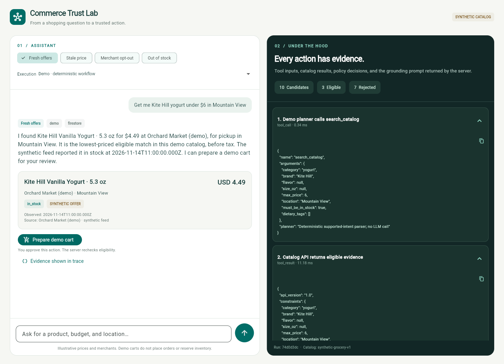
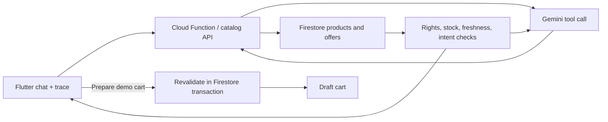

# Commerce Trust Lab

A two-pane commerce agent prototype: a shopper asks for a product on the left; the right pane shows the catalog tool call, exact constraints, permitted evidence, policy decisions and draft-cart action.

Built as a portfolio exploration for a **Principal Product Manager — Commerce AI Platform** role. It connects marketplace product judgment with developer-platform design. It is independent of Microsoft and the example brands.

**Try:** “Get me Kite Hill yogurt under $6 in Mountain View.” The agent rejects a stale promotion, unavailable stock, and an opted-out merchant; selects an eligible offer; and offers to prepare a cart. Clicking **Prepare demo cart** revalidates the offer and creates an idempotent draft. It never purchases or reserves inventory.

All prices, merchants, inventory, dietary attributes and demand examples are synthetic. Catalog time is frozen at `2026-11-14T12:00:00Z` for repeatable demonstrations. No merchant integration or real availability is claimed.



## Run now

Requires Node.js 22 or newer. The no-key preview has no npm runtime dependencies:

```sh
npm start
```

Open **http://127.0.0.1:8787** for the browser preview. If Flutter has been built, the actual Flutter app is at **http://127.0.0.1:8787/flutter/**. Both clients use the same backend contract and catalog policy.

**Android:** the Flutter client also has an Android project, mobile chat/trace tabs and local API networking configuration. See [Android setup and APK commands](flutter_app/README.md#android-app). The Android SDK is still required on this Mac; an APK has not yet been built or tested on a native device.

```sh
npm test
npm run eval
```

## Connect a real Gemini endpoint

1. Create or view a key in [Google AI Studio](https://aistudio.google.com/apikey).
2. Copy `.env.example` to `.env.local` if the local file does not exist. Enter the key after `GEMINI_API_KEY=` and select a model available to your account using `GEMINI_MODEL=`. The example uses `gemini-3.5-flash-lite`, listed in the current [Gemini model catalog](https://ai.google.dev/gemini-api/docs/models).
3. Keep the key on the server. `.env.local` is ignored by Git and is never served to clients. Never add the key to Flutter, screenshots, issue text, or a repository.
4. Run `npm run check:gemini` to validate the connection. Refresh the browser preview, select **Gemini**, and submit a supported query. The local server rereads its settings for each API request; an app restart is not needed for a newly entered key.

The live path sends the user's query to Gemini, validates its `search_catalog` arguments independently, executes the catalog API, and sends **only eligible offers** back for evidence selection. A final validated record supplies the answer's factual fields. An invalid model result fails closed; the app does not silently switch to a simulated result. The trace shows the actual request contract and final evidence-selection prompt, not private model reasoning.

**Demo mode is deterministic, not a live LLM.** Gemini calls require your account's access/quota and may incur provider charges. Firebase and Gemini are hosted services; they are not described here as open-source models. An optional local open-source route uses [Ollama](https://github.com/ollama/ollama) and [Qwen3-4B](https://huggingface.co/Qwen/Qwen3-4B): install/pull the model, set `ENABLE_OLLAMA=1`, then select Ollama.

## Flutter + Firebase

The implementation includes working Flutter source and a shared Node service that can use either a local memory adapter or Firestore. Firestore is a **document database**, not a native graph database. Product identities and volatile offers are stored separately:

```text
products/{productId}              canonical brand, flavor, size, dietary tags
products/{productId}/offers/{id}   merchant, price, stock, location, timestamp, controls
cartProposals/{token}             short-lived evidence-bound action proposal
draftCarts/{token}                idempotent draft; no merchant-side order
```



Install Firebase's tools and SDKs locally, then use emulators with a demo project ID (no cloud project required):

```sh
npm ci
npm ci --prefix functions
# Requires Java 21+ and Node 22 for the Firebase toolchain.
npm run emulators
```

In another terminal:

```sh
FIRESTORE_EMULATOR_HOST=127.0.0.1:8080 GCLOUD_PROJECT=demo-commerce-trust npm run seed
USE_FIRESTORE=1 FIRESTORE_EMULATOR_HOST=127.0.0.1:8080 GCLOUD_PROJECT=demo-commerce-trust npm start
```

The Firestore-backed local app runs at port 8787. The Firebase **Cloud Function + Hosting emulator** runs at **http://127.0.0.1:5002**. The Firestore UI is **http://127.0.0.1:4000**. Port 5002 avoids the common macOS AirPlay conflict on port 5000. Seeder writes only to an explicitly configured emulator; it refuses cloud writes.

For Gemini in the Functions emulator, configure server-only values in `functions/.env.local` (also ignored), or start the emulator process with `GEMINI_API_KEY` and `GEMINI_MODEL` set. The root `.env.local` is used only by `server.mjs`.

To build Flutter with an installed Flutter SDK:

```sh
cd flutter_app
flutter pub get
flutter analyze
flutter test
flutter build web --base-href /flutter/ --dart-define=API_BASE=http://127.0.0.1:8787
```

See [Flutter setup](flutter_app/README.md) and [architecture / API contract](docs/architecture.md). The release build is generated locally and excluded from Git. A cloud deployment needs your own Firebase project, private access configuration, model secret, suitable service account/IAM and deployment review; this repository does not automatically deploy or publish anything.

## What to demonstrate in an interview

| Product judgment | Demonstration |
|---|---|
| Shared catalog foundation | Two clients, one versioned catalog API and policy implementation |
| Trusted exposure | Opted-out merchant rows never enter model evidence or client responses |
| Action readiness | Freshness, stock, exact constraints, attribution and cart rights are prerequisites |
| Reliability | Revalidation at action time; a stable retry key produces one draft |
| Evaluation | Explicit synthetic cases and counts; model tests distinguished from policy tests |
| Prioritization | Fix trust and actionable coverage before broadening supply or adding checkout |

Use the [five-minute demo script](docs/demo-script.md) and [product brief](docs/product-brief.md). They distinguish product hypotheses from demonstrated outcomes and connect the prototype to marketplace and developer-platform experience.

## Scope and next steps

Supported intent: one yogurt pickup item, an optional covered brand/flavor/size, vegan/dairy-free tags, a USD budget and one covered city. The conservative parser requests clarification for unsupported wording or constraints. It is deliberately not a general-purpose nutrition or shopping assistant. Dietary values are fixture metadata, not independently verified allergy guarantees.

The trace arrives with the completed API response; it does not pretend to stream model thoughts. Aggregate rejection counts are visible, but opted-out offer identities/prices are withheld. The mock catalog clock and scenario overrides must be replaced by real ingestion timestamps and merchant feeds before any live commerce use.

Production work includes partner identity/authorization, rate limits, observability, signed merchant feed rights, indexed/bounded catalog queries, refresh SLOs, independent model evaluation, session isolation, retention and expiry cleanup. The local/demo access gate is not a production authentication system. A draft is not an inventory reservation.

## Open-source resources and provenance

Original application code and synthetic fixtures are MIT licensed; AI-assisted implementation, reviewed with automated policy tests. No coursework source or employer code is included.

- [Flutter](https://github.com/flutter/flutter) — UI framework; BSD-3-Clause.
- [Firebase Admin Node SDK](https://github.com/firebase/firebase-admin-node) and [Cloud Functions SDK](https://github.com/firebase/firebase-functions) — Apache-2.0; Firebase's cloud service has separate terms.
- [Gemini function calling](https://ai.google.dev/gemini-api/docs/function-calling) — provider API contract; Gemini is a hosted proprietary model service.
- [Schema.org Product](https://schema.org/Product) and [Offer](https://schema.org/Offer) — design references for the product/offer split; this API is not a full Schema.org implementation.
- [Ollama](https://github.com/ollama/ollama/blob/main/LICENSE) — MIT; [Qwen3-4B](https://huggingface.co/Qwen/Qwen3-4B) — Apache-2.0 model license.

The matching role description was reviewed via [the Microsoft application page](https://apply.careers.microsoft.com/careers/job/1970393557051399-principal-product-manager-commerce-ai-platform-united-states-california-mountain-view) and [a full-text job mirror](https://www.olive.jobs/job/pst_6222488ea116a0a5). The numeric job ID `200064968` supplied in the request could not be independently matched in the accessible page text.
