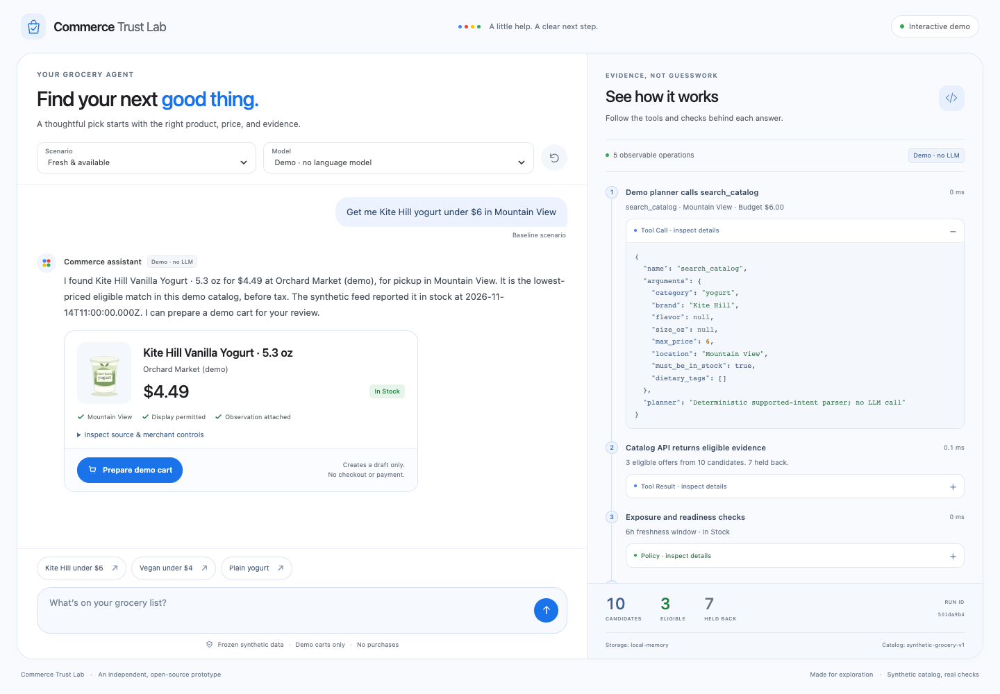
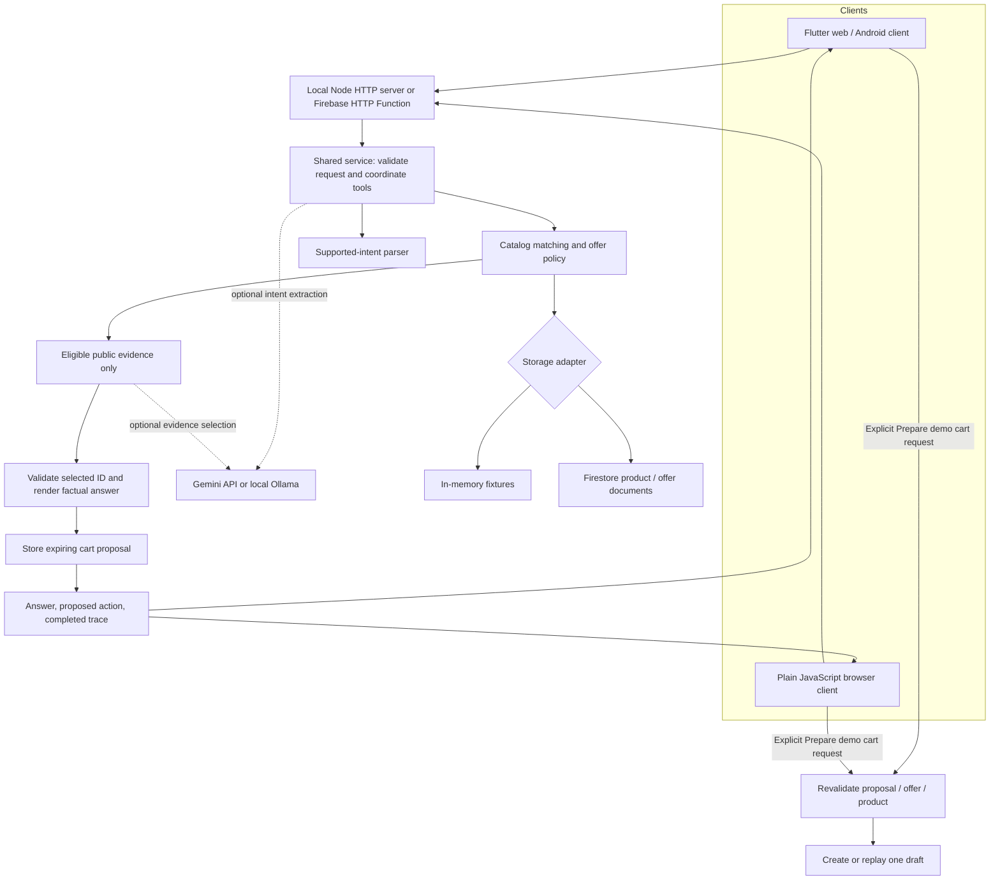

# Commerce Trust Lab

A grocery-shopping agent with an inspectable execution trace. Ask for one yogurt pickup item, compare eligible offers, and explicitly prepare a draft cart. A Flutter client and a lightweight browser client share the same catalog API, eligibility rules, and action service.

> **Try:** “Get me Kite Hill yogurt under $6 in Mountain View.”

The demo finds the lowest-priced qualifying offer, explains which checks ran, and offers **Prepare demo cart**. Clicking that button revalidates the product and offer before writing a draft. It does **not** purchase, charge, reserve inventory, or contact a merchant.

All prices, merchants, inventory, dietary attributes, and source links are synthetic. Brand names illustrate requests without implying affiliation. The catalog clock is frozen at `2026-11-14T12:00:00Z`, so the same fixtures produce repeatable results; displayed stock is not a live availability guarantee.



## What the agent does

- Extracts a supported product request and validates its constraints.
- Searches canonical products and their merchant offers.
- Excludes offers that fail display permissions, freshness, stock, pickup, location, currency, price, or attribution checks.
- Selects the lowest-priced eligible offer, or abstains when none remains.
- Returns the tool parameters, permitted evidence, policy outcomes, and answer-composition step in a trace.
- Creates a short-lived action proposal when the selected merchant permits cart preparation.
- Writes one draft per proposal only after an explicit action request, with safe same-key retries.

The default **Demo** mode is deterministic and makes no model calls. Optional **Gemini** and **Ollama** modes use real model requests for structured intent extraction and evidence selection. They cannot widen the supported request language or bypass the platform's checks. Final answer text always comes from a verified catalog record and an application template.

### Supported request scope

| Constraint | Current behavior |
|---|---|
| Category and quantity | Yogurt; one item with quantity `1` |
| Fulfillment | Pickup only |
| Location | Mountain View or Palo Alto |
| Brand | Kite Hill, Oat Meadow, or unspecified |
| Flavor | Vanilla, plain, or unspecified |
| Package size | Exact numeric size in ounces, when supplied |
| Dietary tags | `vegan` and `dairy_free`, using fixture metadata |
| Budget | USD ceiling greater than `0` and no more than `1000`; eligibility uses `price <= max_price`, before tax |

Unsupported wording, combined alternatives, unknown brands/cities, additional quantities, nutrition claims, delivery, and exclusions require clarification. The parser is deliberately conservative. This is not a general-purpose shopping or allergy-advice system. Chat history is displayed by the clients, but each API request is processed independently; there is no conversational memory.

## Quick start: no model or database required

Use Node.js **22 or newer**. The default local server uses only Node's standard library and the in-memory fixture store:

```sh
git clone https://github.com/codeandsomedata/commerce-trust-lab.git
cd commerce-trust-lab
npm start
```

Open [the browser preview](http://127.0.0.1:8787). Select a scenario and send the example request. **Fresh & available** returns a synthetic eligible offer; **Stale offer**, **Merchant restriction**, and **Out of stock** make all offers fail the corresponding check and produce abstention.

```sh
npm test
npm run eval
```

`npm test` uses Node's test runner. The Firestore integration test is skipped unless an emulator host is configured. `npm run eval` runs twelve deterministic shopping cases; it makes no paid model calls.

If `.env.local` already exists, inspect its settings locally: `server.mjs` can select Firestore or enable model modes from that file. Do not publish credentials. Changing the storage adapter requires a server restart because the store is constructed at startup.

## Technical design

### Components and request paths



The shared implementation lives in `functions/src/`. Both `server.mjs` and the Firebase function call `dispatch()` in `service.mjs`. Storage adapters implement three operations: `catalog(scenario)`, `propose(data)`, and `draft(token, idempotencyKey)`. The clients do not access Firestore or model providers directly.

### Search and model sequence

1. **Validate the request.** The message must contain 1–1,500 characters. The service accepts only the defined scenario and mode values.
2. **Parse supported intent.** `extractDemoIntent()` runs in every mode. Unsupported input returns `status: "clarify"` without a recommendation, proposal, or model call.
3. **Optionally ask a model for a tool call.** A live model must produce exactly one `search_catalog` call. The service validates the arguments and requires the normalized result to equal the independently parsed intent. A changed budget, city, brand, or other constraint fails with HTTP `422` before retrieval.
4. **Retrieve and filter.** Products are matched by category and optional brand, flavor, size, and dietary tags. Candidate offers then pass the policy below. Rejected rows are removed before the evidence-selection model request and before client responses.
5. **Rank and optionally select evidence.** Eligible offers are sorted by ascending price, then `offer_id`. In live mode, a second model request receives the user query and eligible API evidence and returns an `offer_id`, or `null` if there are no offers. It must match the service's first sorted offer exactly. An invented, hidden, or more expensive selection fails with `422`.
6. **Compose the result.** The service renders the answer from the selected record. It does not use free-form model prose as the factual answer. If `allow_cart` is true, it stores a ten-minute proposal tied to that product, offer, price, intent, and scenario.

This is a bounded two-call model workflow, not an open-ended planning loop. The model has one exposed search tool and an evidence-selection step; it has no purchase, payment, catalog-editing, or permission-changing tool. Temperature is set to zero, but correctness comes from validation rather than an assumption of deterministic model output.

### Offer eligibility policy

| Check | Requirement | Rejection reason |
|---|---|---|
| Display rights | `allow_ai_display === true` | `merchant_excluded` |
| Observation time | Valid, not in the future, and at most six hours old relative to the frozen catalog clock | `stale_or_invalid_timestamp` |
| Stock | `availability_status === "in_stock"` | `stock_unverified` |
| Fulfillment | `pickup` | `pickup_unavailable` |
| Location | Case-normalized match to the requested city | `wrong_location` |
| Price and currency | Finite, nonnegative price in USD | `invalid_price_or_currency` |
| Budget | Price no greater than the requested ceiling | `over_budget` |
| Attribution | Attribution field present | `missing_attribution` |
| Cart rights, at action time | `allow_cart === true` | `cart_not_permitted` |

A display-only offer can be recommended without a cart action. Cart rights are not a prerequisite for appearing in search results. The service does not automatically replace the cheapest display-only offer with a more expensive actionable one.

The public projection includes only the documented offer fields and the two public merchant-control flags. Restricted offer IDs, names, prices, attribution, and source URLs are withheld. Aggregate rejection counts remain visible; an offer may fail several checks, so reason counts can sum to more than the number of rejected offers.

### Data model

Firestore is a **document database**. Product-to-offer relationships are represented by document paths; there is no graph database, entity-resolution engine, or inferred product graph.

```text
products/{productId}
  name, brand, category, flavor, size_oz, dietary_tags

products/{productId}/offers/{offerId}
  merchant, price, currency, location, availability_status,
  observed_at, merchant_controls, attribution, source_url, fulfillment

cartProposals/{proposalToken}
  id, product_id, offer_id, price, intent, scenario,
  expires_at, used_key (after successful consumption)

draftCarts/{proposalToken}
  id, status="draft", items, total, currency,
  created_at, catalog_version, note
```

The fixtures contain four canonical products and eleven offers. The Firestore adapter queries all yogurt products, then reads each product's offers subcollection. Product IDs and offer-to-product links are reconstructed from document paths. There are no explicit query limits, pagination, or catalog cache; this access pattern is suitable for the fixture-sized demonstration, not evidence of production scale.

### Draft-cart correctness and concurrency

The recommendation response contains a random proposal token, not a signed checkout token or an order. A first cart request must arrive before the proposal's ten-minute wall-clock expiry. The service rechecks product attributes, product linkage, price equality, stock, display and cart permissions, location, fulfillment, currency, attribution, and freshness.

- **Firestore:** one transaction reads the proposal and existing draft, then the current product and offer. A successful transaction creates `draftCarts/{proposalToken}` and records the used idempotency key on the proposal atomically. Concurrent same-key requests converge on the same draft; a different key for an already consumed proposal receives `409`.
- **Memory:** the equivalent check-and-write happens synchronously within one Node process. Data disappears on restart and is not shared across processes.
- **Retry semantics:** an existing same-key draft is returned before rechecking expiry or present-day offer eligibility. Replay confirms the original draft; it does not assert that the product is still purchasable. Keys are scoped to a proposal, not globally unique across all searches.

Clients retain a stable key for retrying a given action. A new search creates a new proposal and can create a separate draft. There is no cross-user binding, durable cleanup policy, reservation, merchant order, or checkout protocol.

## HTTP API

| Method and route | Request | Result |
|---|---|---|
| `GET /api/health` | None | Storage mode, configured model modes, fixture version and clock |
| `POST /api/agent` | `message`, optional `scenario` and `mode` | `ready`, `clarify`, or `abstained`; answer, recommendation, action proposal, trace, and counts |
| `POST /api/v1/catalog/search` | Structured intent | `api_version: "1.0"`, eligible offers, constraints, metrics, and rejection counts; always uses baseline fixtures |
| `POST /api/cart` | Proposal `token`, `idempotency_key` | Draft and action trace, or an error |

```sh
curl http://127.0.0.1:8787/api/agent \
  -H 'Content-Type: application/json' \
  -d '{"message":"Get me Kite Hill yogurt under $6 in Mountain View","scenario":"baseline","mode":"demo"}'
```

Structured catalog request:

```json
{
  "category": "yogurt",
  "brand": "Kite Hill",
  "flavor": "vanilla",
  "size_oz": 5.3,
  "max_price": 6,
  "location": "Mountain View",
  "must_be_in_stock": true,
  "dietary_tags": ["vegan"]
}
```

Unknown structured-search fields are rejected. Optional brand/flavor may be omitted or empty; omitted/null/zero size means unspecified. `dietary_tags` must be an array, and `must_be_in_stock` must be `true`. A cart key must contain 8–100 letters, digits, underscores, or hyphens.

Errors return JSON with an `error` string. Typical statuses are `400` for invalid input, `401` for a failed deployed-demo access gate, `404` for an unknown route/proposal, `409` for expired or changed action evidence or an alternate retry key, `422` for a model disagreement, `502` for dependency/model failures, and `503` for an unconfigured model. The local server also rejects oversized request bodies with `413`. Clarification and abstention are normal `200` results, not transport failures. See [the detailed API and trust-boundary reference](docs/architecture.md).

## Optional model modes

### Gemini

Use a model available to your account. The repository does not bundle Gemini or require it for the default demo.

1. Obtain credentials through [Google AI Studio](https://aistudio.google.com/apikey).
2. If absent, copy `.env.example` to `.env.local`. Set `GEMINI_API_KEY` and `GEMINI_MODEL` locally. Keep this file out of Git.
3. Start the server, refresh the preview, and select Gemini. The local server rereads allowed settings on API requests; storage-adapter changes still require a restart.
4. Optionally run `npm run check:gemini` to make an actual two-call connection check using the synthetic catalog. This can use provider quota and incur charges; it is separate from the offline tests.

The key is sent to Google's API in a server-side header, never in a prompt or browser bundle. A supported live request sends the user query to Gemini; the second call also sends eligible catalog evidence. No raw excluded rows are included. Upstream error bodies are not copied into client errors, and failures do not silently fall back to Demo mode.

### Ollama

Install [Ollama](https://github.com/ollama/ollama) and a compatible tool-calling model, for example the configured default `qwen3:4b`:

```sh
ollama pull qwen3:4b
```

Set `ENABLE_OLLAMA=1` and optionally `OLLAMA_MODEL` in the server environment or root `.env.local`. The adapter calls `http://127.0.0.1:11434/api/chat`. Model downloads and inference requirements are separate from this repository. `/api/health` reports configuration flags, not a verified provider connection or model readiness.

Each model request has a 45-second timeout. A live run makes two sequential requests. Both clients use a 90-second HTTP timeout, and the Firebase function is configured for 120 seconds; a slow provider can therefore cause the client to time out before a response. Draft actions remain explicit separate requests.

## Flutter client

The Flutter client uses the same light surfaces, blue actions, rounded offer cards, and expandable trace details as the browser workbench.


With Flutter **3.50+** and Dart **3.14+** installed:

```sh
cd flutter_app
flutter pub get
flutter analyze
flutter test
flutter run -d chrome --dart-define=API_BASE=http://127.0.0.1:8787
```

To serve a release web build from the root Node server:

```sh
flutter build web --release --base-href /flutter/ \
  --dart-define=API_BASE=http://127.0.0.1:8787
```

Then open [the Flutter app](http://127.0.0.1:8787/flutter/). The server reads `flutter_app/build/web/` directly. Build output is ignored by Git. Wide screens show chat and trace side by side; narrow screens use tabs.

Android source is also included. Debug builds default to `http://10.0.2.2:8787` for the Android emulator. A USB-connected device can use `adb reverse tcp:8787 tcp:8787` and `API_BASE=http://127.0.0.1:8787`. Android profile/release builds require an explicitly configured endpoint and HTTPS. See [Flutter and Android setup](flutter_app/README.md); native Android build/device validation is separate from Flutter web and widget tests.

## Firebase and Firestore emulators

Use Node **22** for the declared Functions runtime and Java **21+** for the emulator toolchain:

```sh
npm ci
npm ci --prefix functions
npm run emulators
```

The launcher uses the demo project ID `demo-commerce-trust`, starts Firestore/Functions/Hosting, and stores downloaded emulator binaries under ignored `.tools/firebase-emulators/`. It can discover a project-local macOS JDK under `.tools/jdk/*/Contents/Home`; otherwise configure Java normally. This command does not deploy cloud resources.

In another terminal, seed the running emulator:

```sh
FIRESTORE_EMULATOR_HOST=127.0.0.1:8080 GCLOUD_PROJECT=demo-commerce-trust npm run seed
```

The seeder requires `FIRESTORE_EMULATOR_HOST`; it does not seed a cloud database. It upserts the fixture products/offers without deleting existing draft carts.

| Service | Local address |
|---|---|
| Hosting → Cloud Function → Firestore | [127.0.0.1:5002](http://127.0.0.1:5002) |
| Function base | `http://127.0.0.1:5001/demo-commerce-trust/us-central1/commerce` |
| Firestore | `127.0.0.1:8080` |
| Emulator UI | [127.0.0.1:4000](http://127.0.0.1:4000) |

Hosting serves the plain-web client and rewrites `/api/**` to `commerce`. It does not serve the Flutter build under the current configuration. Port 5002 avoids the common macOS port-5000 conflict.

To keep the Node server and Flutter `/flutter/` route while using the same Firestore emulator, stop the earlier server and restart it with:

```sh
USE_FIRESTORE=1 FIRESTORE_EMULATOR_HOST=127.0.0.1:8080 \
  GCLOUD_PROJECT=demo-commerce-trust npm start
```

The root `.env.local` is read only by `server.mjs` and the Gemini check script. For Functions-emulator model configuration, use server-side environment variables or ignored `functions/.env.local` instead.

## Security and deployment boundary

The local Node server listens only on loopback. Browser CORS allows HTTP localhost/loopback origins. Firestore rules deny direct client reads and writes; the Admin SDK relies on server IAM and application policy. Those rules do not independently constrain Admin SDK operations.

Outside the emulator, the Firebase function requires `Authorization: Bearer <DEMO_ACCESS_TOKEN>` and binds that value as a server secret. Set `ENABLE_GEMINI=1` to include the Gemini key in its deployed secret bindings; `GEMINI_MODEL` remains server configuration. An optional `DEMO_ORIGIN` controls the additional allowed browser origin. No credential values belong in source, traces, screenshots, or client code.

The Flutter client can send a configured demo access token, but a token compiled into an APK or web bundle is extractable. It is a private-demo gate, not user authentication. Proposal tokens are random bearer capabilities and are not bound to a user. There is no automatic cloud deployment in this repository. A public service needs real authentication/authorization, session binding, rate limits, retention, and operational controls.

## Tests and evaluation

```sh
# Policy, contracts, in-memory actions, and mocked model adapters
npm test

# Twelve synthetic deterministic shopping cases
npm run eval

# Real local Firestore transactions, with emulator running
FIRESTORE_EMULATOR_HOST=127.0.0.1:8080 GCLOUD_PROJECT=demo-commerce-trust \
  node --test functions/test/firestore.test.mjs
```

Tests cover eligible results, abstention, exact constraints, restricted-data exclusion, invalid/future timestamps, display-only merchants, changed product/offer rejection, proposal expiry, replay keys, unsupported model tool calls, model constraint changes, and invented selections. The Firestore test changes an offer and checks rejection, then sends four concurrent same-key draft requests and checks deduplication. It removes its isolated documents afterward.

Flutter tests cover the HTTP contract, endpoint routing, error handling, explicit action approval, stable retry identity, compact layouts, and keyboard behavior. The trace is returned as one completed response; it is not token streaming, live tool-event streaming, or private model reasoning.

See [the validation record](docs/validation.md) for dated results and unverified paths. Offline policy tests, live-model tests, cloud deployment, and production quality are distinct forms of evidence.

## Implemented and future work

**Implemented:** bounded parsing; optional model adapters; canonical product/offer fixtures; shared eligibility policy; versioned catalog response; observable execution trace; explicit proposals and draft creation; memory and Firestore adapters; transactional retries; browser and Flutter clients; local Firebase configuration; tests and synthetic evaluation.

**Not implemented:** merchant ingestion, live prices/stock, broad product identity matching, inventory reservation, checkout/payment/fulfillment, multi-item carts, conversation state, user/partner isolation, rate limiting, production telemetry/SLOs, paginated retrieval, proposal TTL cleanup, or model-event streaming. Real-time freshness requires replacing the frozen fixture clock with a current clock and trusted ingestion timestamps.

## Repository guide

| Path | Responsibility |
|---|---|
| `functions/src/catalog.mjs` | Supported intent, schema validation, product matching, offer policy, public projection |
| `functions/src/service.mjs` | HTTP dispatch, request orchestration, grounded response, action proposal |
| `functions/src/models.mjs` | Gemini/Ollama request adapters and constrained prompts |
| `functions/src/store.mjs` | Shared draft validation and process-local store |
| `functions/src/firestore-store.mjs` | Firestore reads, proposal persistence, action transaction |
| `functions/src/index.mjs` | Firebase HTTP function, demo access gate, CORS, secret bindings |
| `functions/src/fixtures.mjs` | Synthetic catalog, frozen clock, failure scenarios |
| `server.mjs` | Loopback API and browser/Flutter static hosting |
| `web/`, `flutter_app/` | Two clients of the shared API |
| `functions/test/`, `scripts/evaluate.mjs` | Contract tests, transaction test, synthetic cases |
| `docs/` | Architecture, walkthrough, product scope, validation, screenshots |

Additional reading: [architecture and API details](docs/architecture.md), [five-minute walkthrough](docs/demo-script.md), and [product scope and tradeoffs](docs/product-brief.md).

Original application code and synthetic fixtures are MIT licensed; see [LICENSE](LICENSE). The implementation was developed with AI assistance. [Flutter](https://github.com/flutter/flutter), the [Firebase Admin SDK](https://github.com/firebase/firebase-admin-node), [Firebase Functions SDK](https://github.com/firebase/firebase-functions), and optional [Ollama](https://github.com/ollama/ollama)/[Qwen](https://huggingface.co/Qwen/Qwen3-4B) have their own licenses. Firebase cloud services and Gemini have separate service terms. [Schema.org Product](https://schema.org/Product) and [Offer](https://schema.org/Offer) are design references; the API is not a complete Schema.org implementation.
