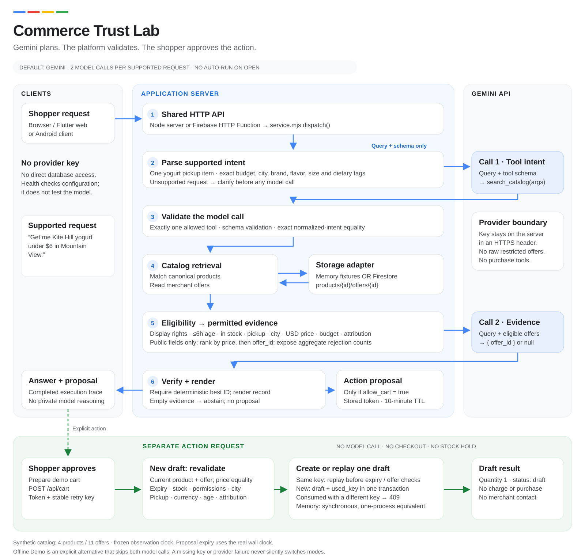
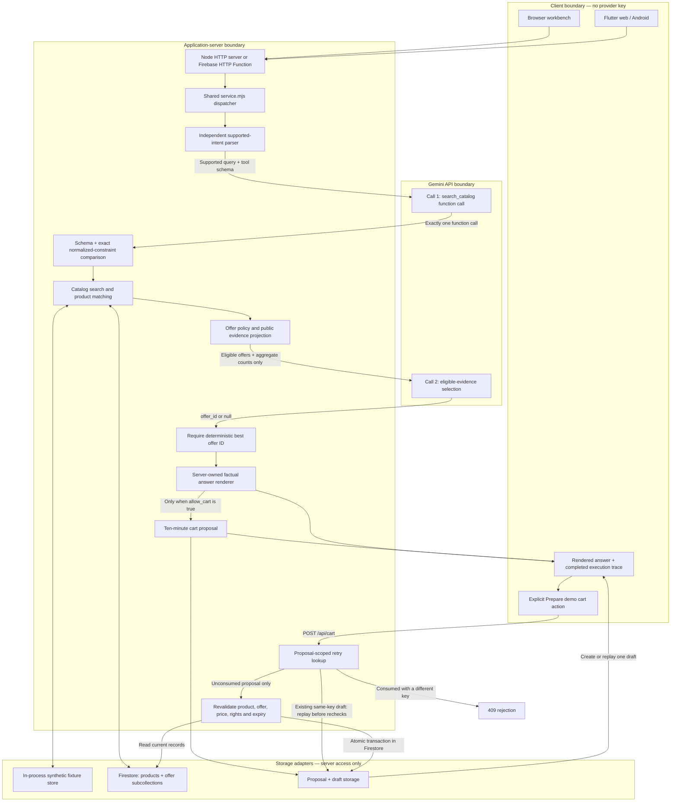

# Architecture and API reference

Commerce Trust Lab has one shared commerce service and two storage adapters. The Flutter app and browser preview call HTTP endpoints; neither reads Firestore or calls a model directly. This document describes the implementation in `functions/src/`, not a proposed production system. Setup commands and the overall component diagram are in the [root README](../README.md).

## Component map and trust boundaries



[Open the full-size SVG](../web/architecture.svg). The diagram has one canonical source in `web/architecture.svg`, also served by the local architecture page. Gemini is selected initially; no model request runs until a shopper submits a message. An omitted API `mode` also selects Gemini. A missing key produces a configuration error rather than silently switching modes.



The model-provider arrows are server-originated HTTPS requests. The API key is an HTTP header, never client state or model context. Restricted raw catalog rows have no path to Gemini. Explicit **Demo** mode bypasses both model calls while retaining the parser, policy, deterministic selection, and draft checks. Optional Ollama replaces the provider adapter within the same bounded workflow.

## Recommendation sequence — default Gemini path

```mermaid
sequenceDiagram
  actor Shopper
  participant UI as Flutter / browser
  participant Service as Shared service
  participant Gemini as Gemini API
  participant Catalog as Catalog policy
  participant Store as Memory / Firestore

  UI->>Service: GET /api/health on open
  Service-->>UI: Default mode + configuration flags (no provider probe)
  Shopper->>UI: Submit one yogurt pickup request
  UI->>Service: POST /api/agent (mode=gemini, or omitted)
  Service->>Service: Validate input and independently parse intent
  alt Unsupported wording or constraints
    Service-->>UI: clarify; no model call, recommendation, or proposal
  else Supported request
    Service->>Gemini: Call 1: query + search_catalog schema
    Gemini-->>Service: Exactly one search_catalog call
    Service->>Service: Validate schema and exact normalized intent
    Note over Service: Constraint disagreement stops before catalog search
    Service->>Catalog: searchCatalog(intent, scenario)
    Catalog->>Store: Read canonical products and merchant offers
    Store-->>Catalog: Internal catalog records
    Catalog->>Catalog: Match product; filter permissions, age, stock,<br/>pickup, city, price, currency, attribution
    Catalog->>Catalog: Public projection; sort by price then offer_id
    Catalog-->>Service: Eligible offers + aggregate rejection counts
    Service->>Gemini: Call 2: query + eligible API evidence
    Gemini-->>Service: JSON offer_id, or null when no eligible offer
    Service->>Service: Require ID to equal deterministic best offer
    Note over Service: Invented or different ID stops before proposal creation
    alt No eligible offer
      Service-->>UI: abstained + completed trace
    else Eligible offer
      Service->>Service: Render factual answer from selected record
      opt Selected merchant permits cart preparation
        Service->>Store: Persist random ten-minute proposal
        Store-->>Service: Proposal token
      end
      Service-->>UI: ready + record + optional action + completed trace
    end
  end
```

Neither initial page load nor the health request calls Gemini. Configuration flags are not connectivity proof. The chosen model must be available to the configured key, and each supported live request can consume quota. No live-provider success is implied by offline tests or mock responses. The trace is assembled during execution and returned at the end; it does not stream tokens, tool events, or model reasoning.

## Approved action sequence — Firestore adapter

```mermaid
sequenceDiagram
  actor Shopper
  participant UI as Client
  participant Service as Shared service
  participant DB as Firestore transaction

  Shopper->>UI: Click Prepare demo cart
  UI->>Service: POST /api/cart (proposal token + stable key)
  Service->>Service: Validate token/key format
  Service->>DB: Begin transaction; read proposal and prior draft
  Note over DB: Replay lookup precedes expiry and current-offer revalidation
  alt Proposal already consumed with the same key
    DB-->>Service: Replay existing draft (no fresh eligibility assertion)
  else Proposal consumed with a different key
    DB-->>Service: Reject 409
  else New draft request
    DB->>DB: Read current product and offer
    DB->>DB: Check expiry, product identity/attributes, price equality,<br/>stock, rights, city, pickup, currency, age, attribution
    alt Evidence changed, missing, expired, or ineligible
      DB-->>Service: Reject; no draft written
    else Evidence valid
      DB->>DB: Atomically create draftCarts/token<br/>and record used_key on cartProposals/token
      DB-->>Service: One draft for this proposal
    end
  end
  Service-->>UI: Draft + action trace, or explicit error
```

Existing same-key drafts take an early replay branch, before expiry or current-offer checks. Only a new draft requires the revalidation shown in the action lane. Concurrent same-key requests converge on the same draft. The memory adapter applies the same checks synchronously in one process, without database durability or cross-process transactions. Neither adapter purchases, charges, reserves inventory, or contacts a merchant. The server receives an explicit action request; it cannot independently prove that a human physically clicked a button.

## Module responsibilities

| Module | Responsibility |
|---|---|
| `catalog.mjs` | Conservative request parser, structured-intent validation, product matching, offer eligibility, explicit public projection |
| `models.mjs` | Model configuration flags, one-tool extraction request, constrained evidence-selection request |
| `service.mjs` | Orchestration, independent model-result validation, factual answer template, proposal generation, route dispatch |
| `store.mjs` | Shared action-time validator and in-memory store |
| `firestore-store.mjs` | Firestore catalog reads, proposal writes, transactional draft creation/replay |
| `index.mjs` | Firebase HTTP wrapper, CORS, deployed-demo token gate and secret bindings |
| `fixtures.mjs` | Four canonical products, eleven synthetic offers, frozen clock, scenario overrides |

The local `server.mjs` handles HTTP parsing and static assets, then uses the same dispatcher. It creates its store at process startup. Reading new model settings does not switch an already constructed storage adapter.

## API contract

All successful endpoints return JSON. The local base is `http://127.0.0.1:8787`; Firebase Hosting forwards the same `/api/**` routes to the `commerce` HTTP function. The direct function base includes `/demo-commerce-trust/us-central1/commerce` in the emulator.

### `GET /api/health`

Returns:

```json
{
  "storage": "local-memory",
  "modes": {"demo": true, "gemini": false, "ollama": false},
  "default_mode": "gemini",
  "gemini_model": null,
  "catalog_version": "synthetic-grocery-v1",
  "synthetic": true,
  "snapshot_at": "2026-11-14T12:00:00.000Z"
}
```

`storage` becomes `firestore` for that adapter. This example represents an unconfigured provider. `default_mode` remains `gemini`; `gemini_model` reports the configured model ID or `null`. Mode flags indicate configured environment variables, not a connection test. Health does not query Firestore, fetch a model, or verify quota.

### `POST /api/agent`

```json
{
  "message": "Get me Kite Hill yogurt under $6 in Mountain View",
  "scenario": "baseline",
  "mode": "gemini"
}
```

`scenario` defaults to `baseline`; allowed alternatives are `stale`, `restricted`, and `out_of_stock`. Each alternative overlays the corresponding failure on **all** offers without changing stored records. `mode` defaults to `gemini`; alternatives are explicitly selected `demo` (offline) and `ollama` (local provider). The example configuration selects `gemini-3.5-flash-lite`; the server uses `GEMINI_MODEL`, not a hard-coded model ID.

The response includes `run_id`, `mode`, `storage`, `catalog_version`, `status`, `answer`, `recommendation`, `action`, `trace`, and `metrics`.

| Status | Recommendation | Action |
|---|---|---|
| `clarify` | `null`; request lies outside the supported parser contract | `null` |
| `abstained` | `null`; no eligible offer remains | `null` |
| `ready` | The first eligible offer sorted by price, then offer ID | Proposal only if this offer has cart permission |

A proposal has `type: "prepare_cart"`, a button label, and a random `token`. The server stores it before returning the response. An agent request never creates a draft cart; the client must make a separate action request. The server does not independently prove that a physical click occurred, so an authorized API caller can also request the action directly.

### `POST /api/v1/catalog/search`

```json
{
  "category": "yogurt",
  "brand": "Kite Hill",
  "flavor": "vanilla",
  "size_oz": 5.3,
  "max_price": 6,
  "location": "Mountain View",
  "must_be_in_stock": true,
  "dietary_tags": ["vegan", "dairy_free"]
}
```

The required semantic inputs are category `yogurt`, a supported city, finite `max_price` in `(0,1000]`, `must_be_in_stock: true`, and an array of supported dietary tags. Optional brand/flavor values must be covered or empty; omitted/null/zero size means unspecified, while a positive size must match exactly. Tags are deduplicated and sorted during validation. Unknown keys receive `400`.

This endpoint always uses `baseline` and makes no model call or proposal. It returns `api_version: "1.0"`, normalized `constraints`, `catalog_clock`, `price_scope`, an `offers` array, `metrics`, and `rejection_counts`. The price ceiling is inclusive, despite example requests using the word “under.” Prices cover one pickup item before tax.

Metrics count candidate offers after product matching, eligible offers, and rejected offers. A row may contribute to several rejection reasons. These are fixture counts, not latency, conversion, or production-quality measurements.

### `POST /api/cart`

```json
{
  "token": "<proposal UUID returned by /api/agent>",
  "idempotency_key": "stable_key_for_this_proposal"
}
```

The key must be 8–100 characters from `[A-Za-z0-9_-]`. The response contains `cart` and an action trace. A cart has one quantity-1 item, status `draft`, a total in USD, creation time, fixture version, and an explicit no-purchase/no-reservation note.

### Error behavior

| HTTP status | Examples |
|---|---|
| `400` | Empty/oversized message, unsupported mode/scenario, invalid search constraints, invalid cart parameters; malformed JSON in local server |
| `401` | Missing or incorrect deployed-demo access token |
| `404` | Unknown endpoint/method combination or proposal token |
| `409` | Expired unconsumed proposal, removed or changed offer/product, alternate key for a consumed proposal |
| `413` | Local server request body exceeds its 20,000-character accumulation limit |
| `422` | Model intent differs from independent parsing, or model chooses a different offer ID |
| `502` | Model protocol/upstream/dependency failure or unexpected internal exception |
| `503` | Requested model mode is not configured |

Errors use `{"error":"message"}`. Clarification and abstention remain successful HTTP responses. A failed model run does not switch to deterministic mode automatically.

## Model trust boundary

The independent parser runs first in **every mode**. Gemini/Ollama therefore do not expand the accepted vocabulary or infer extra unsupported constraints. Model-extracted intent is schema-validated and compared field by field with the normalized parser result.

The extraction adapter allows exactly one function call named `search_catalog`. Gemini is configured with an allowlisted function declaration; both adapters validate the returned call. The first request contains the user's message and the schema, not catalog rows.

The second request contains the user's message and eligible API evidence. It requests JSON containing an offer ID, not a prose recommendation. The service requires the same ID it would select deterministically, including the offer-ID tie-breaker. If evidence is empty, the required selection is `null`. Final factual answer fields come from the record, even if the model returns additional text or fields.

Merchant text is explicitly described as untrusted data in the prompts. Authoritative safeguards are the limited tool surface, exact constraint check, filtered projection, validated selection, and server-owned factual renderer. Prompt wording alone is not a claim of immunity to adversarial model behavior.

The Gemini key is sent in `x-goog-api-key`, not the request body. The final selection prompt, eligible input, and validated selection are visible in the execution trace; the Gemini adapter excludes thought-marked response parts when parsing selection. The trace does not expose private model reasoning or claim to stream execution.

## Offer exposure and clocks

Product matching preserves the requested category, brand, flavor, size, and dietary tags. Offer checks require display permission, valid observation time within six hours, `in_stock`, pickup, requested city, USD and a finite nonnegative price, budget compliance, and attribution. The public projection copies only the two named merchant-control booleans rather than all internal controls.

Rejected rows, including restricted identities and prices, are omitted from API evidence and traces. Aggregate reason counts are exposed. Source links are synthetic `example.com` references; a source URL is not fetched or validated by the service.

Two clocks are intentionally different:

- **Catalog eligibility:** evaluated against `SNAPSHOT`, the fixed fixture time. The passage of real time does not age an offer in this demo.
- **Proposal lifecycle:** expires ten minutes after creation using `Date.now()`; draft timestamps also use the real wall clock.

Action-time checks repeat the catalog policy, but still use the fixed catalog clock. A real ingestion system must replace this with current-time validation and trusted observation timestamps.

## Action transaction and retry identity

`FirestoreStore.draft()` reads `cartProposals/{token}` and `draftCarts/{token}` within a transaction. It rejects an unknown proposal or a different key if the proposal was consumed. If the draft already exists for the same key, it returns that record immediately.

For a new draft, it reads the current product and offer, reapplies the proposal's scenario, and calls shared validation. Validation requires an unexpired proposal, existing records, the original price and product link, current product constraints, and all exposure/cart checks. The transaction creates the draft and records `used_key` together. Concurrent requests that read the same unconsumed proposal cannot independently commit separate drafts at that path.

The key is scoped to the proposal. The canonical draft document key is the full proposal token; the shorter `cart.id` in the response is a display identifier derived from that token. The Flutter client derives its stable retry key from the run ID; the browser client retains a generated key per run.

A completed same-key retry returns the prior draft even if the proposal has since expired or stock has changed. This is replay of an earlier result, not readiness for checkout. There is no payment or reservation API to execute afterward. A new search produces a new proposal, so deduplication is not global across shopping attempts.

The memory store has equivalent local semantics with maps and no suspension inside its check/write sequence. It does not offer cross-process consistency or restart durability. The Firestore transaction is the adapter that provides database concurrency control.

## Security, storage, and operational limits

Firestore product documents contain canonical attributes; their offer subcollections contain volatile merchant data. Proposals and drafts are separate collections. This models relationships in a document database; it is not a graph query engine. Catalog reads are a category query followed by one subcollection read per matching product, with no explicit pagination or fan-out bound. Reads for a recommendation are not a single catalog-wide transaction; draft creation revalidates the selected records transactionally.

Firestore rules deny all direct client reads/writes. Admin SDK access uses server IAM and bypasses these client rules, so service-side checks remain essential. The local server binds loopback without an authentication layer. The deployed function uses a shared bearer token as a private-demo gate; proposal tokens are bearer capabilities without user binding. CORS restricts browser origins but is not authorization for arbitrary HTTP clients.

Server-only settings control Gemini/Ollama. Deployment binds `DEMO_ACCESS_TOKEN` as a secret, and conditionally binds `GEMINI_API_KEY` when `ENABLE_GEMINI=1`. Flutter's optional demo gate token is client-visible if compiled into a bundle; it must not be confused with a protected model-provider secret.

Each model call times out after 45 seconds; clients time out after 90 seconds; the function is configured for 120 seconds, 256 MiB, and at most two instances. These are configuration values, not measured availability or throughput guarantees. There is no retry/backoff layer for model calls, background refresh, persistent telemetry pipeline, rate limit, session isolation, or proposal cleanup/TTL job.

Before broader use, the next engineering work is authenticated users/partners, scoped capabilities, ingestion and revocation, a real clock, bounded indexed retrieval, cleanup, observability, and independent model evaluation. Checkout would require a new merchant-side protocol and another readiness check. None of those future capabilities are implied by the current draft action.
